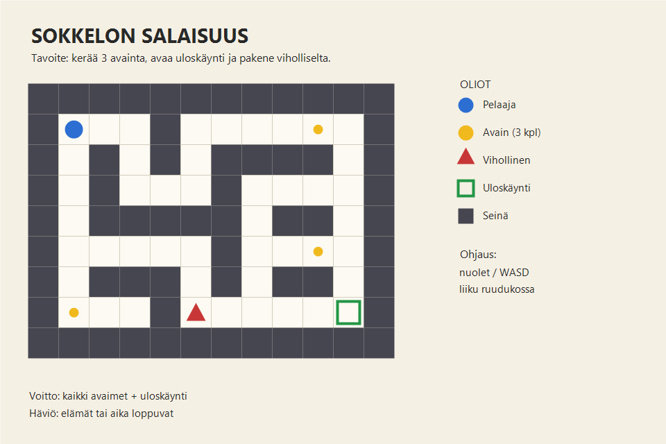

# Harjoitustyön suunnitelma

## Tietoja

Tekijä: Jegor Zadorozhnyi

Työ git-varaston osoite: <https://github.com/niasikwq333/ohj1ht>

Pelin nimi: Sokkelon salaisuus

Pelialusta: Windows

Pelaajien lukumäärä: 1

## Pelin tarina

Olet tutkimusmatkailija, joka löytää metsästä vanhan kivisokkelon.
Sokkelon sisällä on kolme avainta ja liikkuva varjo.
Kun keräät kaikki avaimet, voit avata uloskäynnin ja paeta.

## Pelin idea ja tavoitteet

Peli on ylhäältä kuvattu sokkelo. Pelaaja liikkuu ruudusta toiseen
nuolinäppäimillä tai WASD-näppäimillä.

Pelin tavoitteet:

- kerää kolme avainta
- väistä varjoa
- avaa uloskäynti
- kerää pisteitä jäljellä olevalla ajalla

Peli päättyy voittoon, kun kaikki avaimet on kerätty ja pelaaja pääsee ulos.
Peli päättyy häviöön, jos elämät tai aika loppuvat.

## Hahmotelma pelistä

## Pelin eteneminen

1. Peli alkaa ensimmäisestä tasosta.
2. Pelaaja etsii kolme avainta.
3. Varjo liikkuu sokkelossa ja yrittää osua pelaajaan.
4. Kun kaikki avaimet on kerätty, uloskäynti avautuu.
5. Pelaaja menee uloskäynnille, ja taso päättyy.
6. Seuraava taso on isompi ja varjo liikkuu nopeammin.
7. Kolmannen tason jälkeen peli päättyy.

## Pelin oliot

| Olio | Toiminto | Suhde muihin |
|------|----------|--------------|
| Pelaaja | Liikkuu ja kerää avaimet | Kerää avaimet ja menee ulos |
| Seinä | Estää liikkumisen | Rajaa käytävät |
| Avain | Kerättävä esine | Avaimet avaavat uloskäynnin |
| Varjo | Liikkuu kohti pelaajaa | Vie pelaajalta elämän |
| Uloskäynti | Lopettaa tason | Aukeaa, kun avaimet on kerätty |
| Ajastin | Mittaa aikaa | Ajan loppuessa peli päättyy |
| Pistelaskuri | Laskee pisteet | Näytetään tason lopussa |

## Toteutuksen suunnitelma

Viikko 1:

- tutustun Jypeliin ja teen projektin rungon
- piirrän kartan taulukosta

Viikko 2:

- teen pelaajan liikkumisen
- lisään seinät ja törmäystarkistuksen
- lisään avaimet ja uloskäynnin

Viikko 3:

- lisään varjon liikkumisen
- lisään elämät, ajastimen ja pisteet
- teen toisen ja kolmannen tason

Viikko 4:

- teen voitto- ja häviöruudut
- viimeistelen ulkoasun
- testaan pelin ja tarkistan koodin
