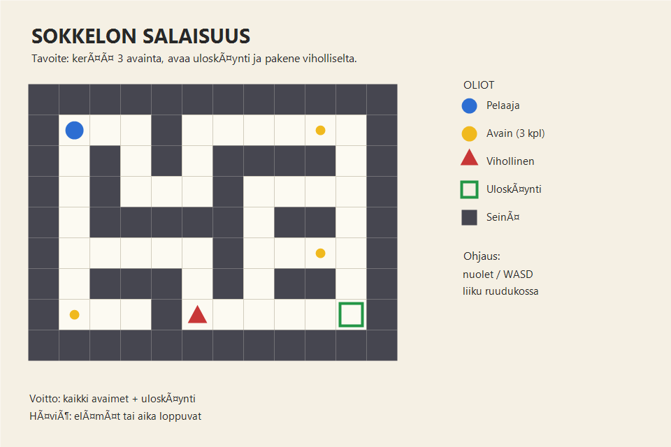

# Harjoitustyön suunnitelma

## Tietoja

Tekijä: Jegor Zadorozhnyi

Työ git-varaston osoite: <https://github.com/niasikwq333/ohj1ht>

Pelin nimi: Sokkelon salaisuus

Pelialusta: Windows

Pelaajien lukumäärä: 1

## Pelin tarina

Olet nuori tutkimusmatkailija, joka löytää metsän keskeltä ikivanhan kivisokkelon.
Sokkelon sisällä on kolme maagista avainta, jotka avaavat tien ulos. Sokkeloa
vartioi kuitenkin liikkuva varjo, joka ei päästä tunkeilijoita helpolla.

Tehtäväsi on kerätä kaikki kolme avainta, avata uloskäynti ja paeta sokkelosta
ennen kuin aika loppuu. Jokainen osuma varjoon vie yhden elämän.

## Pelin idea ja tavoitteet

Peli on ylhäältä kuvattu ruudukkosokkelo, jossa pelaaja liikkuu ruudulta toiselle
nuolinäppäimillä tai WASD-näppäimillä.

Pelin tavoitteet:

- kerää kolme avainta sokkelon eri osista
- väistä liikkuvaa vihollista
- löydä avautunut uloskäynti ja poistu sokkelosta
- kerää mahdollisimman paljon pisteitä jäljelle jääneellä ajalla

Peli päättyy voittoon, kun pelaaja on kerännyt kaikki avaimet ja päässyt ulos.
Peli päättyy häviöön, jos elämät tai aika loppuvat.

## Hahmotelma pelistä

## Pelin eteneminen

1. Peli käynnistyy aloitusruudusta, jossa näkyvät ohjeet ja pelin tavoite.
2. Pelaaja liikkuu sokkelossa ja etsii kolme avainta.
3. Vihollinen liikkuu ennalta määritettyä reittiä pitkin ja yrittää osua pelaajaan.
4. Avainten keräämisen jälkeen uloskäynti avautuu ja muuttuu vihreäksi.
5. Pelaaja siirtyy uloskäynnille, jolloin taso päättyy ja pistelaskuri näyttää tuloksen.
6. Seuraava taso on hieman suurempi ja vihollinen liikkuu nopeammin.
7. Kolmannen tason jälkeen peli päättyy voittoruutuun.

## Pelin oliot ja niiden toiminnot

| Olio | Toiminto | Suhde muihin olioihin |
|------|----------|------------------------|
| Pelaaja | Liikkuu ruudukossa, kerää avaimet, väistää vihollista | Kerää avaimet, törmää seinin ja viholliseen, poistuu uloskäynnistä |
| Seinä | Estää liikkumisen | Ympäröi käytävät ja rajaa pelialueen |
| Avain | Kerättävä esine | Pelaaja kerää avaimet, jotka avaavat uloskäynnin |
| Vihollinen | Liikkuu reittiä pitkin | Osuessaan pelaajaan vie yhden elämän |
| Uloskäynti | Tason lopetus | Avautuu, kun kaikki avaimet on kerätty |
| Ajastin | Mittaa jäljellä olevaa aikaa | Ajan loppuessa peli päättyy |
| Pistelaskuri | Laskee pisteet avaimista ja ajasta | Näytetään tason lopussa |

## Toteutuksen suunnitelma

### Tekninen rakenne

- `Sokkelo`-luokka perii Jypelin `Game`-luokan.
- Kenttä tallennetaan kaksiulotteisena taulukkona `char[,]`, jossa eri merkit
  kuvaavat seiniä, käytäviä, avaimia, vihollista ja uloskäyntiä.
- Koko kenttä piirretään silmukalla taulukon läpi.
- Avaimet tallennetaan listaan `List<GameObject>`, jotta niiden määrää ja
  sijaintia on helppo käsitellä.
- Funktio `OnkoSeina(int x, int y)` tarkistaa taulukosta, voiko pelaaja siirtyä
  kyseiseen ruutuun, ja palauttaa `bool`-arvon.
- Funktio `LaskePisteet(int avaintenMaara, double jäljelläOlevaAika)` laskee
  tason pisteet ja palauttaa kokonaisluvun.
- Aliohjelmat `LuoKentta`, `LiikutaPelaajaa`, `TarkistaTormaykset`,
  `AloitaTaso` ja `LopetaPeli` jakavat pelin logiikan selkeisiin osiin.
- Vakioilla (`const`) määritetään esimerkiksi ruudun koko, avainten määrä,
  elämien määrä ja tason aika.

### Aikataulu

Viikko 1

- Git-varasto, solution ja projektin runko
- suunnitelman viimeistely ja esittely ohjaajalle
- kentän piirtäminen taulukosta silmukalla

Viikko 2

- pelaajan liikkuminen ja seinien törmäystarkistus
- avainten kerääminen ja uloskäynnin avautuminen
- funktio `OnkoSeina`

Viikko 3

- vihollisen liikkuminen ja törmäystarkistus
- elämät, ajastin ja pistelaskuri
- funktio `LaskePisteet`
- toinen ja kolmas taso

Viikko 4

- voitto- ja häviöruudut
- ulkoasun viimeistely, äänet ja dokumentointi
- koodin läpikäynti tyylioppaan mukaan
- loppupalautus ja etävaraston toimivuuden testaus

Jos aikaa jää

- animaatiot pelaajalle ja viholliselle
- satunnaisesti muuttuvat sokkelot
- ennätyslista
